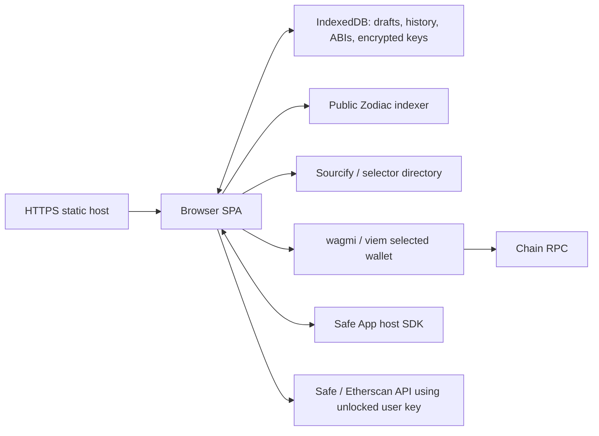

# SafeRoles static architecture

The app is now a React + Vite SPA. `dist/` contains HTML, scripts, styles, icons,
a Safe manifest and static host header instructions. There is no Worker entry,
application database, login or same-origin API. No SSR is needed for this console.

| Boundary | Modules |
| --- | --- |
| Entry and providers | `app/main.tsx`, `wallet-provider.tsx` |
| Policy authoring and review | `policy.ts`, `policy-codec.ts`, `policy-plan.ts`, `use-policy.ts` |
| Local full-state planner | `app/lib/zodiac-compat/` LGPL source and tests |
| Indexer snapshot parsing | `roles-reader.ts`, `browser-data.ts` |
| Browser persistence and version checks | `local-db.ts`, `local-workspace.ts`, `use-drafts.ts` |
| Browser ABI cache/manual overrides | `browser-data.ts`, `abi-source.ts`, `use-abi.ts` |
| User credential encryption and session state | `api-keys.ts`, `api-key-settings.tsx` |
| Wallet discovery and selected-provider RPC | `wallet-config.ts`, `use-wallet.ts`, `wallet-rpc.ts` |
| Safe proposals and observations | `use-safe.ts`, `safe-status-reader.ts`, status component |
| Initialization | `initialization.ts`, `setup-page.tsx` |

## Authority and freshness

Local drafts/history are editable convenience records, not chain authority.
Source inputs and imports are validated. Deployed role keys remain locked.
Baseline fingerprints and pre-submission rechecks are retained: an indexer error
never becomes an empty policy and an observed successful transaction never
silently authorizes another diff built on an old baseline. The indexer remains
an availability/freshness dependency, not an independent state proof.

Transactions use the actual selected provider, with account/network/connector
checks and fresh atomic-capability requirements. Initialization does not permit
sequential fallback. An ordinary Safe owner EOA is not treated as the Safe account.

## Local data

IndexedDB stores versioned draft policies, typed submission references, ABI
entries and separate encrypted credential envelopes. Draft updates perform a
version comparison and write in one transaction. Import creates a new record;
export selects only draft fields and excludes credentials. Scope and baseline
checks apply after import exactly as they do to manual edits.

No cross-device or multi-user cloud workspace is provided. Storage errors are
shown and current edits remain exportable. Browsers may partition storage in a
Safe iframe. Existing hosted D1 records are neither imported nor deleted.

API keys stay in memory until encrypted save is explicitly selected. Web Crypto
uses PBKDF2-SHA256 and AES-256-GCM, with fresh salt/IV and service-bound additional
data. Passwords and derived keys are not persisted. Session keys clear on reload
or explicit lock. Encryption at rest does not isolate unlocked data from page
scripts. Keys are sent only to fixed provider origins, with redirects forbidden;
provider CORS failures must remain visible rather than trigger an opaque proxy.

## Deployment and validation

Cloudflare Pages and Vercel header configurations are checked in. AWS requires
equivalent CloudFront response headers and a protected S3 origin or Amplify.
Actual hosting headers/CORS and a real Safe iframe/wallet session remain
production acceptance checks. Unit tests cover local transaction conflicts,
import/export validation, key tampering/wrong password/deletion, role planning,
provider identity and Safe observation boundaries. Static checks reject server
artifacts and old same-origin API calls in the output.

## Configuration screens

Safe selection, setup and transaction review render as full pages with a shared
header and fixed action bar. Creating a role happens inline. Selecting a
permission opens a full-width editor with an explicit return to the permission
list. Core configuration does not use dialog overlays. Wallet selection and
local workspace utilities retain short-lived dialogs.

Form values and key help text use 16px text; labels and secondary metadata use
at least 14px. Blocked submission states explain the first blocker beside the
submit control, with access to all checks and an explicit retry. An RPC failure
never counts as evidence that an address is vacant.
